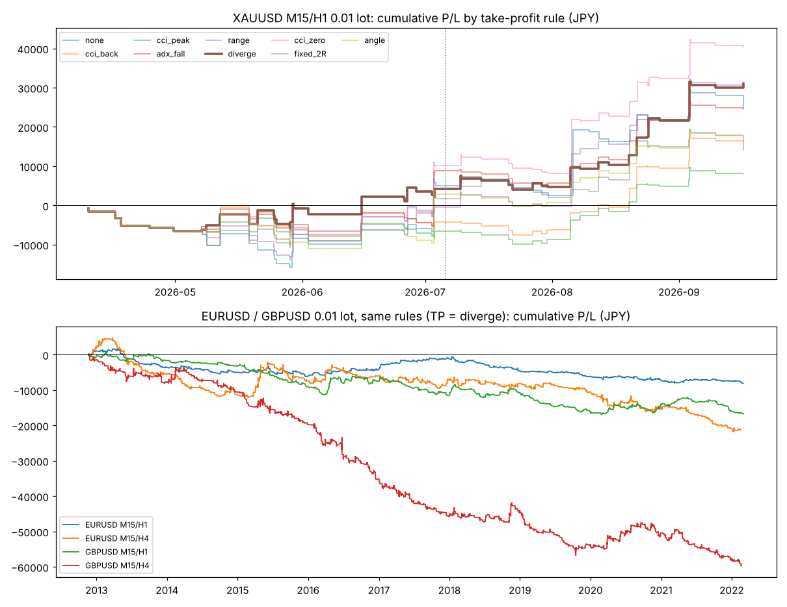

# CCI 押し目買い (風林火山) EA

CCI を使った押し目買い手法を MT5 の EA にし、同じロジックの Python バックテスターで検証したもの。

**検証結果の詳細は [results/results.md](results/results.md) を参照。**

## 結論 (要約)

* 画像のルールで勝てたのは **金 (XAUUSD)・15分足エントリー・1時間足で環境認識** の組み合わせだけ。
  約6か月 (2026/4〜9) で 54 回、勝率 41%、PF 2.12、0.01 ロットで +31,070円、最大DD 6,579円。前半 (下落局面)・後半 (上昇局面) とも黒字。
* 同じ環境の中でランダムにエントリーした場合と比べると、この成績を上回ったのは 300 回中 1〜2%。CCI のトリガーにはある程度意味がありそう。ただし取引回数が少なく、データは半年分だけ。
* **EURUSD・GBPUSD (2012〜2022年) では、ほぼすべての設定で赤字。** コストを 0 にしても PF 1 未満で、この手法の優位性は見られなかった。
* 利確「勢いがなくなりレンジになりそうな時」は、早く降りる定義 (CCI のピークアウト、+100 割れ) ほど成績が悪かった。
  **「高値を更新したのに CCI が前のピークを超えない (ダイバージェンス)、または CCI が 0 割れ」で降りる定義が全体で1位**で、EA の既定値にした。
* 画像で「精度が高い」とされる陽線包み足・20EMA・フィボの条件は、成績をはっきり改善しなかった。画像にない「押し安値の少し下の緊急損切」は効果があった。

> **重要:** 金のデータは半年分しかない。本番前に MT5 ストラテジーテスターで数年分の金データを使って検証し、デモ口座でフォワードテストすること。
> MQL5 の EA はこの環境でコンパイル・実行できないため未検証 (Python 版と同じ手順で1本ずつ再生するテストで、ロジックが一致することは確認済み)。



## ディレクトリ構成

```
fx/ea/cci_pullback/
├── mql5/CCIPullbackEA.mq5  … EA 本体
├── cci_bt.py               … バックテストエンジン (指標・シグナル・売買シミュレーション)
├── data.py                 … データ読み込み (1分足 → 5分/15分/1時間/4時間足)
├── fetch_data.py           … データ取得 (data/ に保存, コミットしない)
├── study.py                … 総当たり (8つの銘柄・時間足 × 2,880 通り)
├── report.py               … results.md / equity.png / 推奨設定の取引一覧を作る
├── results/                … 検証結果
└── tests/test_cci_bt.py    … 検算 (CCI の定義, 上位足の未来参照なし, EA と同じ手順の再生との一致)
```

## EA (CCIPullbackEA.mq5)

### 動作

1. エントリー足 (既定 M15) の新しい足ができた時だけ判定する。シグナルは確定足で見て、新しい足の最初のティックで成行買い。
2. **① 環境認識**: 上位足 (既定 H1) の確定足で、直近2つのスイング高値・安値 (左右2本のフラクタル) がどちらも切り上がり、終値が直近の押し安値より上。さらに上位足 CCI(14) ≥ 50。
3. **② トリガー**: エントリー足の CCI(14) が前の足で -100 以下、確定足で -100 を上抜け。
4. エントリー時に **緊急損切** として「直近10本の安値 - 0.2×ATR」に逆指値を置く。
5. **③ 損切**: 確定足で CCI < -100 かつ陰線なら成行決済。
6. **③ 利確**: CCI が +100 以上に達した後、選んだ利確方法の条件を満たしたら成行決済 (既定 = ダイバージェンス or CCI<0)。
7. 買いのみ、同時に1ポジション。決済した足では新規エントリーしない。
8. 保有中の判定はエントリー足から毎回計算し直すので、EA や MT5 を再起動しても状態が失われない。

### 入力パラメータ

| パラメータ | 既定値 | 説明 |
|---|---|---|
| InpLot | 0.01 | ロット |
| InpEntryTF / InpTrendTF | M15 / H1 | エントリー足 / 環境認識足 |
| InpCCIPeriod | 14 | CCI 期間 (エントリー足) |
| InpEnvMode | スイング構造 | 上昇トレンドの判定 (スイング構造 / EMA50 / なし) |
| InpEnvCCIMin | 50 | 上位足 CCI の下限。-1000 で無効 |
| InpSwingK / InpTrendBars | 2 / 500 | スイング判定の左右本数 / 使う上位足の本数 |
| InpTrigLevel | -100 | CCI の上抜けレベル |
| InpMaxDepth / InpDepthLookback | 0 / 20 | 押しの深さ上限 (例 200 → -200 より深い押しは見送り)。0 で無効 |
| InpUseCandle | false | 陽線包み足 or 下ヒゲ反発 (下ヒゲが足の50%以上) を要求 |
| InpUseEMATouch | false | 直近10本の安値が 20EMA + 0.5ATR 以下まで来たことを要求 |
| InpUseFib | false | 押しが上位足の直近上昇波の 38.2〜78.6% であることを要求 |
| InpStopRule | true | CCI -100 割れ + 陰線確定で撤退 |
| InpUseHardSL / InpSLLookback / InpSLAtrBuffer | true / 10 / 0.2 | 緊急損切 (直近N本の安値 - 0.2ATR) |
| InpTPMode | ダイバージェンス or CCI<0 | 利確方法 (下表) |
| InpTPLevel | 100 | 利確判定を始める CCI レベル |
| InpRangeN / InpRangeK | 6 / 2.0 | 「値幅が縮小」の本数・ATR 倍率 |
| InpAngleTh | 150 | 「角度で切替」で急とみなす 3本の CCI 上昇幅 |
| InpMaxBars | 0 | 最大保有本数 (0 = 無制限) |
| InpMaxSpreadPoints | 0 | これより広いスプレッドでは新規エントリーしない (0 = 制限なし) |
| InpMagic | 20261015 | マジックナンバー |

利確方法 (いずれも CCI が +100 以上に達した後に判定):

| InpTPMode | 内容 | 金 M15/H1 の PF |
|---|---|---|
| ダイバージェンス or CCI<0 (既定) | 高値更新したのに CCI がピーク未満、または CCI < 0 | 2.12 |
| CCI が 0 を割り込む | 長く引っ張る。金では損益最大だが他の銘柄では2〜3位 | 2.31 |
| 値幅が縮小 | 直近6本の高安幅 < 2ATR (レンジ化) | 1.95 |
| ADX が低下 | トレンドの強さが落ちた | 1.85 |
| CCI 角度で切替 | 3本で CCI が 150 以上上がっていればピークアウトで、緩やかなら 0 割れで決済 | 1.61 |
| CCI が +100 を割り込む | 勢い喪失 | 1.57 |
| CCI がピークアウト | 前の足より CCI が下がった | 1.28 |
| 固定 2R | 緊急損切幅の2倍で指値 (比較用) | 1.38 |
| 利確なし | 損切ルールのみ (比較用) | 1.58 |

### 導入手順

1. `mql5/CCIPullbackEA.mq5` を MT5 の `データフォルダ/MQL5/Experts/` にコピーし、MetaEditor でコンパイル (F7)。
2. XAUUSD (ブローカーによっては `GOLD` など) のチャートに EA をドラッグ。チャートの時間足は何でもよい (判定は InpEntryTF / InpTrendTF で行う)。
3. 「アルゴリズム取引」を有効にする。ヘッジ口座・ネッティング口座のどちらでも動く (1ポジションのみ)。
4. 金の 1 lot = 100 oz を前提に検証している。0.01 lot なら金が $1 動くと約 150円の損益。

## Python バックテスター

```
pip install -r requirements.txt
python3 fetch_data.py   # data/ にデータを用意
python3 study.py        # 総当たり (4コアで約2分) → results/grid.csv.gz
python3 report.py       # results.md / equity.png / recommended_trades.csv
python3 -m pytest tests -q
```

検証の前提:

* シグナルは確定足で判定し、次の足の始値で売買 (未来の足は見ない)。上位足は下位足の確定時刻までに確定した足だけを使う。
* 緊急損切は足の途中で判定 (窓開けは始値で約定)。固定 2R の指値と同じ足で両方に届いた場合は損切を優先。
* 買いは ask (bid + スプレッド)、売りは bid。
* コスト: 金 スプレッド $0.30・買いスワップ -$50/lot/日、EURUSD 0.5pips・GBPUSD 0.7pips・買いスワップ -$5/lot/日。USDJPY 150 固定。
* データ: 金 = getdata-finance 無料サンプルの1分足 (2026-03-26〜09-25, MIT, 金ナンピンEAと同じ)、EURUSD/GBPUSD = ejtraderLabs/historical-data の15分足・1時間足 (2012-11〜2022-03)。
