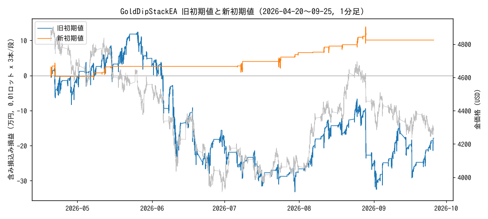

# GoldDipStackEA 改良版の探索

* データ: XAUUSD 1 分足 2026-03-26〜2026-09-25 (getdata-finance 無料サンプル, MIT)。取引は 2026-04-20 から (H4 SMA100 のウォームアップ後)。
  前半 = 〜2026-07-06 (下落局面)、後半 = それ以降 (上昇・反落)。
* 0.01 ロット x 3 本/段。スプレッド $0.30、買いスワップ $30/ロット/日 (水曜 3 倍)、USDJPY 158 固定。
  0.50 ロット (Chieko さんと同じ) なら金額はすべて 50 倍。
* 探索 151,200 通り。前半・後半とも黒字 16,785 通り (11%)。
  損切りなし 21,600 通りのうち前半・後半とも黒字は 14%。
* 選び方 (この順に絞る): 損切りあり / 前半・後半とも黒字 / PF > 1.1 / 100 バスケット以上 → 8 週間 x 15 期間のうち 12 期間以上黒字
  → コスト悪化 (スプレッド $0.50, スワップ $50) でも黒字 → 近傍合格率 60% 以上 → 純損益 / 最大DD が最大。
  ここまで残ったのは 74 通り (成績が同じものはまとめた数)。

## 新しい初期値

| 設定 | バスケット数 | 勝率 | PF | 純損益 | 最大DD | 最悪1回 | 前半 | 後半 | 15期間黒字 | 期間最悪DD | 近傍合格率 | コスト悪化時 |
|---|---|---|---|---|---|---|---|---|---|---|---|---|
| 高値 480分 / 押し目 $60 / 幅 $15 / 最大 2 段 / 利確 $3 / 損切り $40 / H4 SMA100 / 時間切れ 24時間 / 休み 24時間 | 109 | 98% | 2.33 | +10.1万 | 4.3万 | -3.8万 | +2.6万 | +7.5万 | 15/15 | 4.3万 | 86% | +9.6万 |

## 旧初期値 (比較)

| 設定 | バスケット数 | 勝率 | PF | 純損益 | 最大DD | 最悪1回 | 前半 | 後半 | 15期間黒字 | 期間最悪DD | 近傍合格率 | コスト悪化時 |
|---|---|---|---|---|---|---|---|---|---|---|---|---|
| 高値 60分 / 押し目 $20 / 幅 $15 / 最大 3 段 / 利確 $5 / 損切り $30 / なし / 時間切れ なし / 休み 0時間 | 861 | 93% | 0.93 | -17.9万 | 45.5万 | -4.4万 | -21.8万 | +4.0万 | 4/15 | 43.8万 | nan% | -25.0万 |

## 頑健な設定の上位 10 (純損益 / 最大DD 順)

| 設定 | バスケット数 | 勝率 | PF | 純損益 | 最大DD | 最悪1回 | 前半 | 後半 | 15期間黒字 | 期間最悪DD | 近傍合格率 | コスト悪化時 |
|---|---|---|---|---|---|---|---|---|---|---|---|---|
| 高値 480分 / 押し目 $60 / 幅 $15 / 最大 2 段 / 利確 $3 / 損切り $40 / H4 SMA100 / 時間切れ 24時間 / 休み 24時間 | 109 | 98% | 2.33 | +10.1万 | 4.3万 | -3.8万 | +2.6万 | +7.5万 | 15/15 | 4.3万 | 86% | +9.6万 |
| 高値 480分 / 押し目 $60 / 幅 $9 / 最大 2 段 / 利確 $3 / 損切り $100 / H1 EMA50 / 時間切れ 24時間 / 休み 24時間 | 121 | 100% | inf | +21.4万 | 9.1万 | +0.1万 | +10.6万 | +10.9万 | 15/15 | 9.1万 | 86% | +19.4万 |
| 高値 480分 / 押し目 $60 / 幅 $15 / 最大 2 段 / 利確 $3 / 損切り $40 / H1 EMA50 / 時間切れ 24時間 / 休み 24時間 | 131 | 98% | 2.76 | +13.3万 | 5.7万 | -3.8万 | +7.4万 | +5.9万 | 15/15 | 5.7万 | 87% | +12.4万 |
| 高値 240分 / 押し目 $60 / 幅 $25 / 最大 2 段 / 利確 $20 / 損切り $20 / なし / 時間切れ 24時間 / 休み 0時間 | 135 | 59% | 1.36 | +20.5万 | 9.1万 | -1.9万 | +12.2万 | +8.3万 | 15/15 | 9.1万 | 62% | +13.7万 |
| 高値 60分 / 押し目 $20 / 幅 $25 / 最大 5 段 / 利確 $3 / 損切り $20 / H4 SMA100 / 時間切れ 72時間 / 休み 24時間 | 192 | 90% | 1.37 | +6.7万 | 3.0万 | -1.0万 | +4.1万 | +2.6万 | 13/15 | 2.7万 | 67% | +5.0万 |
| 高値 240分 / 押し目 $60 / 幅 $25 / 最大 2 段 / 利確 $30 / 損切り $20 / なし / 時間切れ 24時間 / 休み 0時間 | 107 | 50% | 1.48 | +25.4万 | 11.6万 | -1.9万 | +17.6万 | +7.8万 | 15/15 | 11.6万 | 60% | +22.3万 |
| 高値 240分 / 押し目 $60 / 幅 $40 / 最大 2 段 / 利確 $30 / 損切り $20 / なし / 時間切れ 24時間 / 休み 0時間 | 110 | 50% | 1.49 | +25.3万 | 11.6万 | -1.0万 | +18.6万 | +6.7万 | 15/15 | 11.6万 | 73% | +23.6万 |
| 高値 240分 / 押し目 $60 / 幅 $25 / 最大 2 段 / 利確 $20 / 損切り $20 / なし / 時間切れ 72時間 / 休み 0時間 | 135 | 59% | 1.34 | +19.7万 | 9.1万 | -1.9万 | +12.2万 | +7.5万 | 15/15 | 9.1万 | 60% | +12.8万 |
| 高値 240分 / 押し目 $60 / 幅 $40 / 最大 2 段 / 利確 $20 / 損切り $20 / なし / 時間切れ 24時間 / 休み 0時間 | 141 | 58% | 1.37 | +20.7万 | 9.7万 | -1.0万 | +11.2万 | +9.5万 | 15/15 | 9.7万 | 69% | +14.9万 |
| 高値 240分 / 押し目 $60 / 幅 $40 / 最大 2 段 / 利確 $20 / 損切り $20 / なし / 時間切れ 72時間 / 休み 0時間 | 141 | 57% | 1.34 | +19.7万 | 9.7万 | -1.0万 | +11.2万 | +8.4万 | 15/15 | 9.7万 | 67% | +13.8万 |

## 前半だけで選んだ場合 (ナイーブ最適化) の後半

| 設定 | 前半 純損益 | 前半 最大DD | 後半 純損益 | 後半 最大DD |
|---|---|---|---|---|
| 高値 60分 / 押し目 $30 / 幅 $9 / 最大 2 段 / 利確 $5 / 損切り $20 / H4 SMA100 / 時間切れ 72時間 / 休み 0時間 | +6.9万 | 2.3万 | -8.5万 | 11.7万 |
| 高値 240分 / 押し目 $60 / 幅 $60 / 最大 5 段 / 利確 $5 / 損切り $20 / なし / 時間切れ 72時間 / 休み 24時間 | +5.9万 | 2.0万 | -0.9万 | 3.4万 |
| 高値 240分 / 押し目 $20 / 幅 $60 / 最大 3 段 / 利確 $3 / 損切り $40 / H4 SMA100 / 時間切れ 24時間 / 休み 24時間 | +6.9万 | 2.6万 | -18.8万 | 20.0万 |
| 高値 240分 / 押し目 $20 / 幅 $60 / 最大 5 段 / 利確 $3 / 損切り $40 / H4 SMA100 / 時間切れ なし / 休み 24時間 | +6.9万 | 2.6万 | -8.2万 | 10.3万 |
| 高値 240分 / 押し目 $20 / 幅 $9 / 最大 1 段 / 利確 $3 / 損切り $40 / H4 SMA100 / 時間切れ 72時間 / 休み 24時間 | +6.9万 | 2.6万 | -6.3万 | 10.3万 |
| 高値 240分 / 押し目 $20 / 幅 $9 / 最大 1 段 / 利確 $3 / 損切り $40 / H4 SMA100 / 時間切れ 24時間 / 休み 24時間 | +6.9万 | 2.6万 | -17.0万 | 18.1万 |
| 高値 60分 / 押し目 $20 / 幅 $9 / 最大 2 段 / 利確 $10 / 損切り $20 / H4 SMA100 / 時間切れ なし / 休み 24時間 | +10.1万 | 3.8万 | +10.3万 | 5.4万 |
| 高値 240分 / 押し目 $60 / 幅 $40 / 最大 2 段 / 利確 $30 / 損切り $20 / なし / 時間切れ なし / 休み 24時間 | +10.4万 | 4.0万 | +4.7万 | 3.2万 |
| 高値 240分 / 押し目 $60 / 幅 $60 / 最大 5 段 / 利確 $10 / 損切り $20 / なし / 時間切れ 24時間 / 休み 24時間 | +5.2万 | 2.1万 | +0.9万 | 3.2万 |
| 高値 60分 / 押し目 $10 / 幅 $15 / 最大 3 段 / 利確 $5 / 損切り $20 / H1 EMA50 / 時間切れ 24時間 / 休み 24時間 | +12.1万 | 5.1万 | -13.5万 | 14.6万 |

前半上位 10 件のうち後半も黒字: 3 件。

## 要素別

**直近高値の本数 (分)**

| 値 | 前半・後半とも黒字 | 純損益 中央値 | 最大DD 中央値 |
|---|---|---|---|
| 60 | 12% | -7.9万 | 23.6万 |
| 240 | 11% | -10.9万 | 30.5万 |
| 480 | 11% | -15.1万 | 36.1万 |

**押し目**

| 値 | 前半・後半とも黒字 | 純損益 中央値 | 最大DD 中央値 |
|---|---|---|---|
| 10 | 0% | -47.5万 | 65.0万 |
| 20 | 4% | -26.1万 | 50.4万 |
| 30 | 5% | -17.0万 | 38.2万 |
| 40 | 6% | -8.7万 | 26.5万 |
| 60 | 18% | -2.3万 | 15.4万 |
| 80 | 35% | +1.2万 | 6.9万 |

**損切り**

| 値 | 前半・後半とも黒字 | 純損益 中央値 | 最大DD 中央値 |
|---|---|---|---|
| なし | 14% | -12.6万 | 43.1万 |
| 20 | 11% | -5.7万 | 12.6万 |
| 40 | 8% | -10.0万 | 22.7万 |
| 60 | 9% | -12.6万 | 30.6万 |
| 100 | 13% | -12.9万 | 38.3万 |
| 150 | 12% | -16.7万 | 43.1万 |

**トレンドフィルタ**

| 値 | 前半・後半とも黒字 | 純損益 中央値 | 最大DD 中央値 |
|---|---|---|---|
| なし | 8% | -22.0万 | 52.8万 |
| H1 EMA50 | 16% | -13.8万 | 28.2万 |
| H4 SMA100 | 10% | -4.0万 | 19.3万 |

**時間切れ**

| 値 | 前半・後半とも黒字 | 純損益 中央値 | 最大DD 中央値 |
|---|---|---|---|
| なし | 11% | -13.3万 | 33.6万 |
| 24 | 11% | -9.9万 | 27.1万 |
| 72 | 11% | -9.8万 | 29.7万 |

**損切り後の休み**

| 値 | 前半・後半とも黒字 | 純損益 中央値 | 最大DD 中央値 |
|---|---|---|---|
| なし | 11% | -12.4万 | 33.5万 |
| 24 | 12% | -9.5万 | 26.1万 |

**最大段数**

| 値 | 前半・後半とも黒字 | 純損益 中央値 | 最大DD 中央値 |
|---|---|---|---|
| 1 | 9% | -7.3万 | 17.6万 |
| 2 | 11% | -10.5万 | 26.3万 |
| 3 | 11% | -11.2万 | 31.4万 |
| 5 | 12% | -11.6万 | 36.0万 |

**利確**

| 値 | 前半・後半とも黒字 | 純損益 中央値 | 最大DD 中央値 |
|---|---|---|---|
| 3 | 14% | -7.5万 | 23.4万 |
| 5 | 14% | -7.0万 | 23.8万 |
| 10 | 10% | -12.0万 | 30.7万 |
| 20 | 9% | -14.5万 | 35.6万 |
| 30 | 9% | -15.2万 | 37.5万 |

