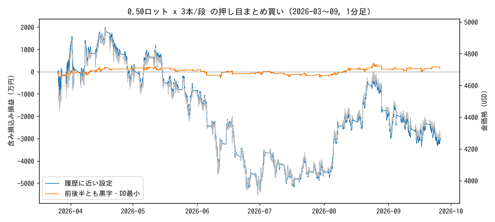

# Chieko さんの取引履歴の検証

## 1. 取引履歴の読み取り (trades.csv)

* 金 (GOLD_USD) の買い 0.50 ロット x 33 本と GBPJPY 売り 3.00 ロット x 1 本。売りの金は 0 本。負けた取引は 1 本も写っていない。
* 時刻は**決済時刻**。同じ時刻帯の決済価格は数ドル以内に揃うが、建値は最大 $18 離れている (10/13 07:38 台: 4172 / 4181 / 4190)。
* 1 本あたりの値幅: 最小 $2.68、中央値 $5.16、最大 $26.96。利確幅は一定ではない。
* 円換算レートは日ごとに 157.7〜158.6 で一定 (MT5 の通常計算と矛盾なし)。
* 同じ塊の決済が 4〜40 秒ずつずれている。EA の一括決済なら 1 秒以内に終わるので、**スマホで 1 本ずつ手動決済している可能性が高い**。

| 日付 | 本数 | 一覧の合計 | 画面上部の損益 | 差 (一覧に無い分) |
|---|---|---|---|---|
| 2026-10-12 | 11 | 291,719 | (写っていない) | — |
| 2026-10-13 | 7 | 663,839 | 635,915 | -27,924 |
| 2026-10-14 | 6 | 364,616 | 364,616 | +0 |
| 2026-10-15 | 4 | 210,653 | 210,653 | +0 |
| 2026-10-16 | 6 | 1,185,954 | 1,171,450 | -14,504 |

画面上部の損益が一覧の合計より少ない日 (10/13 -27,924円, 10/16 -14,504円) は、一覧に写っていない取引かスワップ・手数料がある。
10/16 は 6 本で -14,504円 = 1 本 約 -2,400円 (約 $15 / 0.5 ロット) で、1 晩分の買いスワップとほぼ同じ。

## 2. 推定した手法

* 金の押し目で **0.50 ロットを 2〜6 本 (多いのは 3 本) まとめて買う**。
* 下がったら **$8〜9 下で同じロットを追加** (10/13: 4190 → 4181 → 4172 の 3 段 x 2 本)。ロットは増やさない (マーチンではない)。
* 損切りは見えない。上がったところで手動決済 (10/12 は +$3 前後の小刻み、10/16 は +$22〜27 の大きな利確)。
* 1 段 3 本 = 1.5 ロット = 150 オンス。**$1 動くと 約 2.4 万円**、3 段 (4.5 ロット) なら約 7.1 万円。10/14 の 1 日の値幅は約 $97 で、3 段持っていれば最大 約 690 万円の含み損になり得た幅。

## 3. 推定ルールの機械化とバックテスト

GoldDipStackEA.mq5 / dipstack_bt.py: 直近 60 分高値から「押し目」ドル下げたら 1 段目 (3 本 x 0.5 ロット) を買い、
「買い増し幅」下げるごとに同ロットで追加、平均建値 +「利確」ドルで全決済、「損切り」ドルで全損切り (なしも検証)。
データ: XAUUSD 1 分足 2026-03-26〜2026-09-25 (getdata-finance 無料サンプル, MIT)。前半 = 〜2026-07-06 (下落局面), 後半 = それ以降。
スプレッド $0.30、買いスワップ $30/ロット/日 (水曜 3 倍)、USDJPY 158 固定。証拠金・ロスカットは計算に入れていない (最大DD の金額で判断する)。
10 月のデータは取得できなかったため、スクショの 5 日間そのものの再現はしていない。

* 探索した設定: 936 通り。全期間で黒字 44 通り (5%)、前半・後半とも黒字 11 通り (1%)。
* 損切りなしの設定のうち最大DD が 500 万円を超えたもの: 100%。

### 履歴に近い設定 (押し目 $5, 幅 $9, 最大 3 段, 利確 $5, 損切りなし)

| 押し目 | 買い増し幅 | 最大段数 | 利確 | 損切り | H1トレンド | バスケット数 | 勝率 | PF | 純損益 | 最大DD | 最悪1回 | 最大建玉 | 前半 | 後半 |
|---|---|---|---|---|---|---|---|---|---|---|---|---|---|---|
| $5 | $9 | 3 | $5 | なし | 無 | 113 | 99% | 0.40 | -3,030万 | 7,507万 | -5,023万 | 4.5 | -3,574万 | -219万 |

この設定は 113 回中 112 回勝つが、2026-04-17 に約 $4,952 で買い始めたバスケットが 3 段 (4.5 ロット) のまま
2026-09-25 まで決済できず、この 1 回で -5,023 万円 (スワップ込み)。含み損込み損益の底は -5,514 万円 (2026-06-30)。
ロットを 0.01 x 3 本にすれば金額はすべて 1/50 (最大DD 約 150 万円)。

### 純損益の上位 10

| 押し目 | 買い増し幅 | 最大段数 | 利確 | 損切り | H1トレンド | バスケット数 | 勝率 | PF | 純損益 | 最大DD | 最悪1回 | 最大建玉 | 前半 | 後半 |
|---|---|---|---|---|---|---|---|---|---|---|---|---|---|---|
| $5 | $15 | 10 | $5 | なし | 有 | 588 | 100% | 29.29 | +11,239万 | 13,199万 | -375万 | 15.0 | +561万 | +8,177万 |
| $10 | $15 | 10 | $5 | なし | 有 | 496 | 100% | 28.21 | +9,351万 | 12,061万 | -344万 | 15.0 | +332万 | +6,385万 |
| $10 | $15 | 10 | $5 | なし | 無 | 484 | 100% | 15.62 | +8,696万 | 18,784万 | -595万 | 15.0 | -5,669万 | +7,180万 |
| $20 | $9 | 10 | $5 | なし | 有 | 367 | 100% | 23.58 | +7,759万 | 12,416万 | -344万 | 15.0 | -728万 | +4,472万 |
| $20 | $15 | 10 | $5 | なし | 有 | 343 | 100% | 18.39 | +5,853万 | 11,776万 | -337万 | 15.0 | -1,286万 | +3,268万 |
| $5 | $15 | 10 | $10 | なし | 有 | 229 | 99% | 1.77 | +5,142万 | 13,089万 | -6,425万 | 15.0 | +2,338万 | +1,501万 |
| $20 | $9 | 10 | $3 | $60 | 無 | 1675 | 99% | 1.26 | +3,769万 | 5,882万 | -1,443万 | 15.0 | -551万 | +4,320万 |
| $20 | $5 | 10 | $5 | $60 | 無 | 1199 | 98% | 1.11 | +3,421万 | 5,123万 | -1,429万 | 15.0 | +1,345万 | +2,080万 |
| $20 | $9 | 10 | $10 | なし | 有 | 155 | 99% | 1.49 | +3,137万 | 13,483万 | -6,112万 | 15.0 | +826万 | -696万 |
| $20 | $15 | 10 | $5 | なし | 無 | 505 | 100% | 1.53 | +3,127万 | 11,776万 | -5,609万 | 15.0 | +2,368万 | -2,382万 |

### 前半・後半とも黒字のうち 純損益/最大DD の上位 10

| 押し目 | 買い増し幅 | 最大段数 | 利確 | 損切り | H1トレンド | バスケット数 | 勝率 | PF | 純損益 | 最大DD | 最悪1回 | 最大建玉 | 前半 | 後半 |
|---|---|---|---|---|---|---|---|---|---|---|---|---|---|---|
| $5 | $15 | 10 | $5 | なし | 有 | 588 | 100% | 29.29 | +11,239万 | 13,199万 | -375万 | 15.0 | +561万 | +8,177万 |
| $10 | $15 | 10 | $5 | なし | 有 | 496 | 100% | 28.21 | +9,351万 | 12,061万 | -344万 | 15.0 | +332万 | +6,385万 |
| $20 | $5 | 10 | $5 | $60 | 無 | 1199 | 98% | 1.11 | +3,421万 | 5,123万 | -1,429万 | 15.0 | +1,345万 | +2,080万 |
| $5 | $15 | 10 | $10 | なし | 有 | 229 | 99% | 1.77 | +5,142万 | 13,089万 | -6,425万 | 15.0 | +2,338万 | +1,501万 |
| $20 | $15 | 10 | $3 | $60 | 無 | 1372 | 99% | 1.14 | +1,544万 | 4,527万 | -1,153万 | 12.0 | +803万 | +741万 |
| $20 | $15 | 10 | $5 | $60 | 有 | 462 | 99% | 1.16 | +1,095万 | 3,899万 | -1,142万 | 12.0 | +296万 | +804万 |
| $20 | $5 | 1 | $5 | $30 | 有 | 559 | 86% | 1.02 | +136万 | 498万 | -73万 | 1.5 | +6万 | +134万 |
| $20 | $15 | 10 | $5 | $60 | 無 | 946 | 99% | 1.09 | +1,319万 | 5,450万 | -1,153万 | 12.0 | +835万 | +489万 |
| $20 | $15 | 10 | $3 | $60 | 有 | 672 | 99% | 1.10 | +581万 | 3,113万 | -1,140万 | 12.0 | +415万 | +166万 |
| $20 | $15 | 3 | $5 | $30 | 無 | 1216 | 94% | 1.02 | +374万 | 2,273万 | -220万 | 4.5 | +179万 | +201万 |

最大DD = 確定損益の最高値から、足の安値での含み損込み損益までの最大の落ち込み。必要資金の目安は最大DD の 3 倍以上 (DD 30% 以内)。

