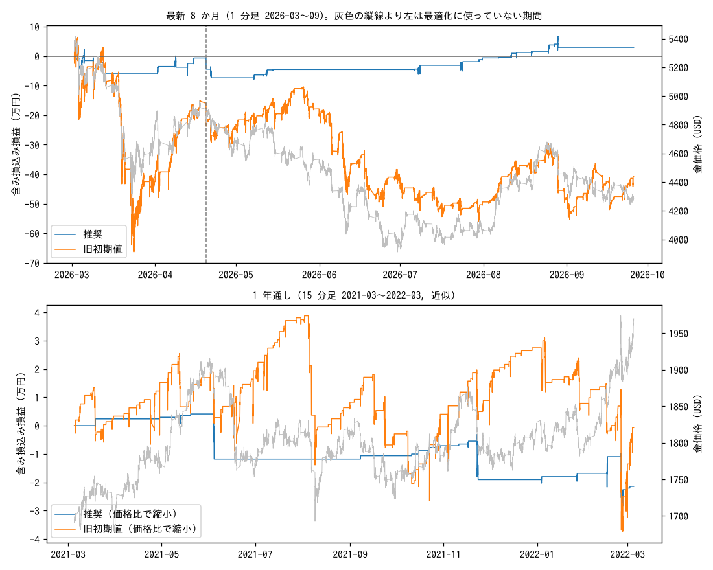

# 推奨設定の長期テスト

推奨設定 = EA の初期値 (高値 480 分 / 押し目 $60 / 幅 $15 / 最大 2 段 / 利確 $3 / 損切り $40 / H4 SMA100 / 時間切れ 24 時間 / 休み 24 時間)。
0.01 ロット x 3 本/段、スプレッド $0.30、買いスワップ $30/ロット/日、USDJPY 158 固定。

## 1. 最新 8 か月 (1 分足 2026-02-01〜2026-09-25)

最新の 1 分足は getdata-finance の無料サンプルの履歴をつないだ約 8 か月が上限 (1 年分は取得できなかった)。
H4 SMA100 のウォームアップ後の 2026-03-01 から取引。2026-04-20 より前は最適化に使っていない検証期間。

| 設定・期間 | 回数 | 勝率 | PF | 純損益 | 最大DD | 最悪1回 |
|---|---|---|---|---|---|---|
| 推奨 / 全期間 | 238 | 96% | 1.09 | +3.0万 | 10.7万 | -3.8万 |
| 推奨 / 検証 (最適化に未使用) | 147 | 95% | 0.83 | -4.4万 | 9.4万 | -3.8万 |
| 推奨 / 最適化に使った期間 | 109 | 98% | 2.33 | +10.1万 | 4.3万 | -3.8万 |
| 旧初期値 / 全期間 | 2111 | 93% | 0.94 | -40.7万 | 72.8万 | -4.4万 |
| 旧初期値 / 検証 (最適化に未使用) | 1250 | 93% | 0.94 | -22.8万 | 72.8万 | -4.3万 |
| 旧初期値 / 最適化に使った期間 | 861 | 93% | 0.93 | -17.9万 | 45.5万 | -4.4万 |

最適化で頑健とした 74 通りのうち、検証期間でも黒字だったのは 8 通り。

**月別 (全期間)**

| 月 | 推奨 | 旧初期値 |
|---|---|---|
| 2026-03 | -5.8万 | -41.1万 |
| 2026-04 | -1.6万 | +17.8万 |
| 2026-05 | +2.8万 | +3.7万 |
| 2026-06 | +0.0万 | -20.2万 |
| 2026-07 | +3.9万 | -9.6万 |
| 2026-08 | +3.6万 | +1.5万 |
| 2026-09 | +0.0万 | +7.2万 |
| 黒字の月 | 3/7 | 4/7 |

## 2. 1 年通し (15 分足 2021-03-05〜2022-03-04, 近似)

ejtraderLabs/historical-data の 15 分足 (23,685 本、取引時間の約 99%)。この期間の金の平均は $1,802、最適化期間は $4,371。
価格比 0.412 でドル幅を縮めた推奨設定: dip $24.74 / step $6.18 / tp $1.24 / sl $16.49。

| 設定・期間 | 回数 | 勝率 | PF | 純損益 | 最大DD | 最悪1回 |
|---|---|---|---|---|---|---|
| 推奨 (価格比で縮小) | 44 | 93% | 0.55 | -2.1万 | 3.2万 | -1.6万 |
| 推奨 (価格比で縮小, スプレッド $0.15) | 45 | 93% | 0.56 | -2.1万 | 3.2万 | -1.6万 |
| 推奨 (ドル幅そのまま) | 3 | 100% | 負けなし | +0.6万 | 1.8万 | +0.1万 |
| 旧初期値 (価格比で縮小) | 257 | 93% | 1.00 | -0.1万 | 7.6万 | -1.9万 |

**近似の偏り**: 2026 年の同じ期間を 15 分足にまとめて走らせると 純損益 +7.5万 / 最大DD 10.1万 (167 回)、
1 分足では +3.0万 / 10.7万 (238 回)。

**月別 (価格比で縮小)**

| 月 | 推奨 | 旧初期値 |
|---|---|---|
| 2021-03 | +0.2万 | +0.3万 |
| 2021-04 | +0.1万 | +1.2万 |
| 2021-05 | +0.1万 | +0.2万 |
| 2021-06 | -1.6万 | +0.2万 |
| 2021-07 | +0.0万 | +1.9万 |
| 2021-08 | +0.0万 | -3.0万 |
| 2021-09 | +0.1万 | -1.1万 |
| 2021-10 | +0.4万 | +0.7万 |
| 2021-11 | -1.2万 | +1.1万 |
| 2021-12 | +0.0万 | +1.3万 |
| 2022-01 | +0.2万 | -2.0万 |
| 2022-02 | -0.5万 | -2.1万 |
| 2022-03 | +0.1万 | +1.3万 |
| 黒字の月 | 7/13 | 9/13 |

