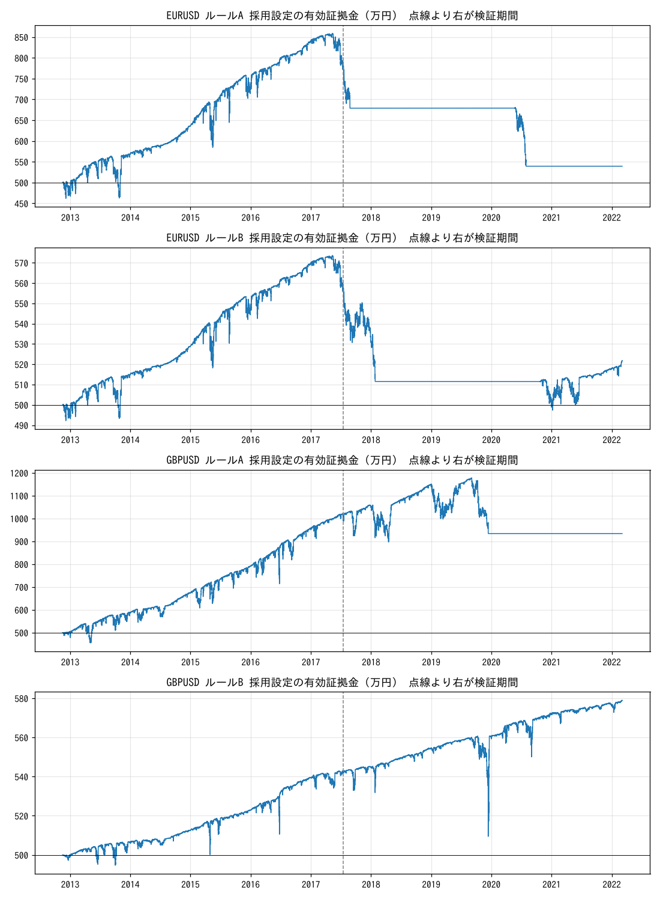

# ナンピンEA:ユーロドル・ポンドドルでの設定探索

金(XAUUSD)向けナンピンEA(`fx/ea/mql5/GoldNanpinEA.mq5`)と同じロジックを EURUSD と GBPUSD に当て、
**前半期間で設定を選び、後半期間でそのまま検証**しました。
各通貨 17,280 通りを総当たりしています。

## 結論

- **「最大DD20%以内で、確実に黒字」になる設定は、ユーロドルにもポンドドルにも見つかりませんでした。**
- **金と同じ選び方(前半でDD20%以内・利益最大)は、両通貨とも後半で不合格でした。**
  EURUSD は後半 +18万円でもDD20.7%、GBPUSD は後半 −163万円・DD34.5%です。前半で最も儲かった設定は、前半の相場に合わせすぎています。
- 前半DD5%以内に絞って選ぶと、EURUSD は後半 +24万円・DD10.4%で合格しました。ただし年1%程度の利回りで、
  2022/03〜2026/10 の日足では −61万円でした。GBPUSD は後半 −35万円で不合格でした。
- GBPUSD の B 設定は、口座損切りを10%から20%かなしに変えるだけで、後半が −35万円から +36万円に変わります。
  前半の成績が同じ設定のどれを選ぶかで、後半の結果が入れ替わるということです。前半の数字は、後半の成績の目安になりません。
- 採用された設定は**すべて「売りのみ」**でした。2012〜2022年はドル高(EURUSD 1.30→1.09、GBPUSD 1.59→1.32)だったためで、
  ドル安が長く続く局面では同じ結果にならない可能性が高いです。

## 通貨ごとの採用設定

元手500万円、国内口座想定(レバレッジ25倍・証拠金維持率100%でロスカット)、スワップは1ロット1日 −5 USD、1ドル150円で換算しています。
括弧内は EA の入力名です。

| | EURUSD A | EURUSD B | GBPUSD A | GBPUSD B |
|---|---|---|---|---|
| 選び方 | 前半DD20%以内で利益最大 | 前半DD5%以内で利益最大 | 前半DD20%以内で利益最大 | 前半DD5%以内で利益最大 |
| 方向(InpDirection) | 売りのみ | 売りのみ | 売りのみ | 売りのみ |
| 初期ロット(InpInitLot) | 0.10 | 0.02 | 0.10 | 0.01 |
| 倍率(InpMultiplier) | 1.5 | 1.5 | 1.5 | 1.2 |
| ナンピン幅(InpGridStep) | 80 pips | 80 pips | 50 pips | 80 pips |
| 最大本数(InpMaxPositions) | 5 | 5 | 5 | 15 |
| 利確幅(InpTPMove) | 40 pips | 40 pips | 10 pips | 40 pips |
| 口座損切り(InpAccountStopPct) | 20% | 10% | 20% | 10% |
| 4時間足100SMAフィルタ | なし | なし | なし | なし |
| 前半 利益 / 最大DD | +286万円 / 18.2% | +59万円 / 4.2% | +515万円 / 18.5% | +43万円 / 3.8% |
| **後半 利益 / 最大DD** | **+18万円 / 20.7%** | **+24万円 / 10.4%** | **−163万円 / 34.5%** | **−35万円 / 10.2%** |
| 後半の判定 | 不合格(DD超過) | 合格 | 不合格(赤字・DD超過) | 不合格(赤字) |
| 後半を15分足で再計算 | +12万円 / 20.8% | +24万円 / 10.4% | −162万円 / 34.2% | −35万円 / 10.2% |
| 2022/03〜2026/10 日足(簡易) | −34万円 / 23.3% | −61万円 / 13.9% | +30万円 / 21.7% | +19万円 / 5.6% |

- 前半 = 2012/11/16〜2017/07/14、後半 = 2017/07/14〜2022/03/04(1時間足)。
- 「合格」は、破綻なし・最大DD20%以内・黒字の3つを満たすことです。
- 「2022/03〜2026/10 日足」は日足終値しかないデータでの確認です。日中の値動きを無視するので、DDは実際より小さく出ます。
- 15分足で再計算しても結果はほぼ同じでした。1時間足の中の値動きの仮定は、結果を大きく歪めていません。
- 海外口座条件(レバレッジ500倍・維持率20%)でも、採用設定のDDは同じでした。証拠金不足になる前に口座損切りが効くためです。



## 破綻した設定の傾向

17,280 通りのうち、ロスカット(破綻)したのは次のとおりです。

| | 前半 | 後半 |
|---|---|---|
| EURUSD | 3,094 通り(18%) | 1,885 通り(11%) |
| GBPUSD | 3,762 通り(22%) | 3,356 通り(19%) |

パラメータごとの後半の破綻率(EURUSD / GBPUSD)は次のとおりです。全体は [results/](results/) の `*_tendency.csv` にあります。

| パラメータ | 破綻しやすい | 破綻しにくい |
|---|---|---|
| 口座損切り | なし:22% / 41% | 10%:0.8% / 3.2% |
| 倍率 | 1.5:22% / 39% | 1.0:0.7% / 2.3% |
| 初期ロット | 0.10:21% / 30% | 0.01:3.4% / 11% |
| ナンピン幅 | 10 pips:19% / 28% | 80 pips:2.2% / 11% |
| 最大本数 | 20本:19% / 32% | 5本:0.1% / 1.1% |
| 方向 | 両建て:13% / 22% | 売りのみ:7.4% / 15% |

- 破綻の大半は「**口座損切りなし × 倍率1.5 × 幅が狭い × 本数が多い**」の組み合わせで起きています。
  一方向に数百 pips 動くと、後半に建てた大きなロットで証拠金が尽きます。
- 口座損切り10%(損切り後1日停止つき)を入れると、破綻はほぼ消えます。ただし損切りで負けを確定させるので、黒字になるとは限りません。
- 買いのみは前半(ドル高局面)でほぼ全滅しました(合格率 EURUSD 2.5%、GBPUSD 0.8%)。両建ても、逆行側のバスケットが同じ理由で崩れます。
- 利確幅は、破綻率にほとんど影響しませんでした。4時間足100SMAフィルタは EURUSD の後半では合格率を上げましたが(23%→35%)、GBPUSD では差がありませんでした。
- 前半で合格した設定のうち、後半も合格した割合は EURUSD 81%、GBPUSD 29% でした。ポンドは前半の結果があてになりにくい通貨です。

## ファイル

| ファイル | 内容 |
|---|---|
| `fetch_data.py` | 過去データの取得(`data/` に保存。データ本体はコミットしない) |
| `nanpin_bt.py` | ナンピンEAのバックテスター(numba で高速化) |
| `optimize.py` | 総当たり・前半最適化・後半検証・結果出力 |
| `tests/test_nanpin_bt.py` | 合成データでの動作テスト |
| `results/summary.md` | 全結果(前半上位10設定とその後半成績、パラメータ別の傾向) |
| `results/best_settings.csv` | 採用設定の一覧 |
| `results/*_top10.csv` / `*_tendency.csv` | 前半上位10・パラメータ別の破綻率 |
| `results/*_in_sample_all.csv.gz` / `*_out_of_sample_all.csv.gz` | 全 17,280 通りの前半・後半成績 |
| `results/equity_best.png` | 採用設定の資産推移 |

## 再現手順

```bash
cd fx/ea/fx_majors
python3 -m pip install pandas numpy numba matplotlib pytest
python3 fetch_data.py          # 約 50MB をダウンロード
python3 -m pytest tests -q     # 7 件
python3 optimize.py            # 4 コアで約 2 分
```

## データ

- 1時間足・15分足 OHLC(2012/11〜2022/03):[ejtraderLabs/historical-data](https://github.com/ejtraderLabs/historical-data)。
  2022年3月で更新が止まっているため、それ以降は使っていません。ライセンス表記がないので、データ本体はコミットしていません。
- 日足終値(〜2026/10):[datasets/exchange-rates](https://github.com/datasets/exchange-rates)(FRED H.10、PDDL)。
- この環境からは Dukascopy・Yahoo などのデータ配信元に接続できませんでした。MT5 からエクスポートした新しいデータがあれば、
  `time,open,high,low,close` の CSV にして `data/EURUSD_H1.csv` を置き換えれば、そのまま回せます。

## バックテストの前提

| 項目 | 値 |
|---|---|
| 元手 | 500万円 |
| 円換算 | 1ドル150円で固定(為替差は無視) |
| 口座 | レバレッジ25倍、証拠金維持率100%でロスカット(=破綻、そこで停止) |
| スプレッド | EURUSD 1.0 pips、GBPUSD 1.5 pips |
| スワップ | 売り買いとも1ロット1日 −5 USD(水曜は3日分)。実際の売りスワップはプラスのことが多いので、売りには不利な仮定 |
| 約定 | 1時間足の中を「陽線は 始→安→高→終、陰線は 始→高→安→終」と動いたとみなし、指値の水準で約定。窓開けは始値で約定 |
| ロット | 初期ロット × 倍率^n を 0.01 単位で四捨五入(MQL の NormalizeDouble と同じ) |
| 証拠金不足 | 余剰証拠金が足りない追加注文は見送り |

## EAのロジック(バックテスターが再現しているもの)

`fx/ea/mql5/GoldNanpinEA.mq5` の入力と約定ルールに合わせています。

1. ポジションが無ければ、バーの始値で初期ロットを建てる。フィルタを使う場合は、確定した4時間足の終値が100SMAより上なら買い、下なら売りだけを新規で建てる(追加のナンピンには使わない)。
2. 最後の建値から「ナンピン幅」だけ逆行するたびに、初期ロット × 倍率^n を 0.01 単位で四捨五入して追加する。最大本数に達したら追加しない。
3. バスケットの合計損益(スワップ込み)が「初期ロットが利確幅だけ動いた分の利益」に達したら、全ポジションを一括決済する。
4. 口座損切り:含み損が残高の指定%に達したら全決済し、その後1440分(1日)は新規を止める。
5. 両建ては、買いと売りのバスケットを独立に同時に動かす。

金用EAとの違いは、価格幅を pips で指定していること、スプレッド上限(InpMaxSpreadPoints)を見ていないことの2点です。

## 注意

- 過去10年でうまくいった設定が今後も通用する保証はありません。特に「売りのみ」はドル高の時期に選ばれた設定です。
- 実運用の前に、MT5 のストラテジーテスター(全ティック)で必ず確認してください。
