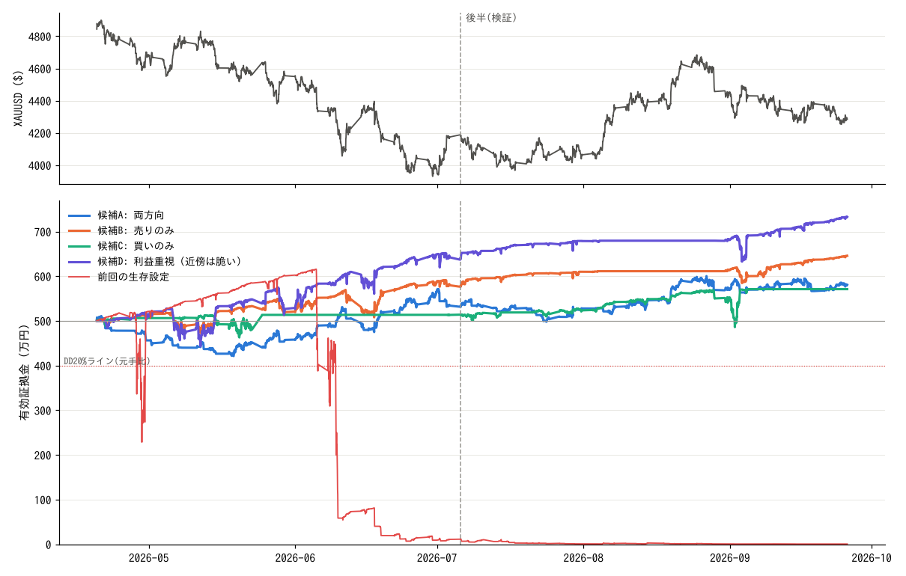

# 金ナンピンEA 探索結果

* データ: XAUUSD 1分足 (getdata-finance 無料サンプル, MIT) 2026-03-26 〜 2026-09-25
* 取引期間: 2026-04-20 〜 2026-09-26 (それ以前はトレンドフィルタのウォームアップ)
  * 前半 (最適化): 2026-04-20 〜 2026-07-06　金 約4,830→4,080ドルの下落局面
  * 後半 (検証): 2026-07-06 〜 2026-09-26　金 約4,000→4,620→4,280ドルの上昇・反落局面
* 口座: 500万円 (USDJPY 150 固定), レバレッジ 100倍, 維持率 50% でロスカット
* コスト: スプレッド $0.30, スワップ 買い $-50 / 売り $-10 (1lot・1日, 水曜3倍)
* 倍率 1.2 固定。合格条件 = 最大DD 20%以内 かつ 黒字 かつ ロスカットなし

## 結論

* 探索 28,800 通りのうち、前半・後半の両方で合格したのは 2,438 通り (8.5%)。
* **前半だけで最適化すると後半はほぼ通用しない。** 前半スコア上位10件のうち後半も合格は 1 件。前半が下落相場だったため「売りのみ・大きめロット」が上位を占め、後半の上昇で崩れた。
* 開始日を1週ずつずらした 15 期間 (各8週) のほぼ全てで合格し、パラメータを1段階ずらしても崩れにくく、コストを悪化させても合格する設定は 73 通り。利益は全期間 (約5か月) で +10〜30% 程度。
* 前回の「生存」設定 (買いのみ・幅$5・最大20本) は今回のデータではロスカットされた。
* 6か月分しか無料の1分足が取得できなかったため、全候補は同じデータで選んでいる。**本番前に必ずデモ口座でのフォワードテストと、MT5 ストラテジーテスターでの長期検証を行うこと。**

## 候補設定

| 区分 | 方向 | 初期ロット | ナンピン幅 | 最大本数 | 利確 | 口座損切り | フィルタ | 前半 利益/DD | 後半 利益/DD | 全期間 利益 | 全期間 DD | 15期間合格 | 期間最悪DD | 近傍合格率 | コスト悪化時 利益/DD |
|---|---|---|---|---|---|---|---|---|---|---|---|---|---|---|---|
| 候補A: 両方向 | 両方 | 0.10 | $100 | 20 | ¥30,000 ($20幅相当) | 5% | H4 SMA100 | +6.5% / 18.1% | +8.8% / 9.4% | +81万円 (+16.2%) | 18.1% | 14/15 | 18.1% | 86% | +19.2% / 14.6% |
| 候補B: 売りのみ | 売りのみ | 0.01 | $10 | 8 | ¥6,000 ($40幅相当) | 15% | H4 SMA100 | +15.5% / 10.9% | +10.7% / 7.3% | +146万円 (+29.1%) | 10.9% | 15/15 | 12.6% | 86% | +27.4% / 11.1% |
| 候補C: 買いのみ | 買いのみ | 0.03 | $50 | 15 | ¥9,000 ($20幅相当) | なし | H4 SMA100 | +2.8% / 10.5% | +11.0% / 16.0% | +71万円 (+14.2%) | 15.5% | 15/15 | 16.2% | 78% | +14.2% / 15.6% |
| 候補D: 利益重視 (近傍は脆い) | 売りのみ | 0.02 | $15 | 8 | ¥3,000 ($10幅相当) | なし | H4 SMA100 | +28.2% / 16.8% | +16.1% / 12.3% | +233万円 (+46.5%) | 16.8% | 15/15 | 17.6% | 56% | +44.1% / 17.0% |
| 前回の生存設定 | 買いのみ | 0.01 | $5 | 20 | ¥1,500 ($10幅相当) | なし | なし | -97.8% / 98.9% | +38.5% / 21.3% | -500万円 (-99.9%) | 100.0% | -/15 | - | 0% | -99.9% / 99.9% |

* 利確: バスケットの合計損益 (スワップ込み) がこの金額に達したら一括決済。初期ロットが指定ドル幅動いた利益に相当。
* 近傍合格率: 初期ロット・幅・本数・利確・損切りのどれか1つを1段階ずらした設定のうち、全期間で合格した割合。
* コスト悪化: スプレッド $0.50, スワップ 買い -$80 / 売り -$30。
* 前回の生存設定は候補ではなく比較用 (期間テスト対象外)。

## ナイーブ最適化 (前半スコア上位) の後半成績

| 設定 | 前半 利益/DD | 後半 利益/DD | 後半合格 |
|---|---|---|---|
| 売りのみ / 初期0.10lot / 幅$50 / 最大5本 / 利確$10相当 / 損切り5% / フィルタ:なし | +39.7% / 11.0% | -6.6% / 27.0% | × |
| 売りのみ / 初期0.10lot / 幅$30 / 最大20本 / 利確$40相当 / 損切り5% / フィルタ:なし | +41.7% / 12.2% | +18.5% / 26.1% | × |
| 売りのみ / 初期0.10lot / 幅$50 / 最大10本 / 利確$5相当 / 損切り5% / フィルタ:なし | +35.7% / 10.7% | -4.7% / 26.0% | × |
| 売りのみ / 初期0.10lot / 幅$50 / 最大8本 / 利確$5相当 / 損切り5% / フィルタ:H1 SMA200 | +41.0% / 12.7% | -7.2% / 18.3% | × |
| 売りのみ / 初期0.10lot / 幅$50 / 最大20本 / 利確$5相当 / 損切り5% / フィルタ:H4 SMA100 | +34.3% / 10.8% | -0.6% / 13.1% | × |
| 売りのみ / 初期0.10lot / 幅$50 / 最大15本 / 利確$10相当 / 損切り5% / フィルタ:H1 SMA200 | +40.4% / 12.8% | -6.7% / 18.7% | × |
| 売りのみ / 初期0.10lot / 幅$75 / 最大8本 / 利確$20相当 / 損切り5% / フィルタ:なし | +33.3% / 10.8% | +1.4% / 25.6% | × |
| 売りのみ / 初期0.10lot / 幅$75 / 最大10本 / 利確$20相当 / 損切り5% / フィルタ:H4 SMA100 | +32.4% / 10.9% | +10.2% / 7.9% | ○ |
| 売りのみ / 初期0.10lot / 幅$50 / 最大15本 / 利確$40相当 / 損切り5% / フィルタ:なし | +36.2% / 12.5% | +6.8% / 24.8% | × |
| 売りのみ / 初期0.03lot / 幅$5 / 最大5本 / 利確$20相当 / 損切り5% / フィルタ:なし | +30.3% / 10.8% | -3.8% / 26.7% | × |

## 要素別の合格率 (%)

**売買方向**

| 値 | 前半 | 後半 | 全期間 |
|---|---|---|---|
| 買いのみ | 12 | 44 | 12 |
| 売りのみ | 51 | 15 | 27 |
| 両方 | 16 | 21 | 14 |

**トレンドフィルタ**

| 値 | 前半 | 後半 | 全期間 |
|---|---|---|---|
| なし | 24 | 23 | 13 |
| H1 SMA200 | 23 | 20 | 13 |
| H4 SMA100 | 32 | 37 | 27 |

**口座損切り**

| 値 | 前半 | 後半 | 全期間 |
|---|---|---|---|
| なし | 31 | 22 | 15 |
| 5% | 25 | 33 | 22 |
| 10% | 22 | 30 | 18 |
| 15% | 27 | 22 | 17 |

H4 SMA100 フィルタが最も安定。方向を固定する設定は相場の向きが変わると崩れる。

